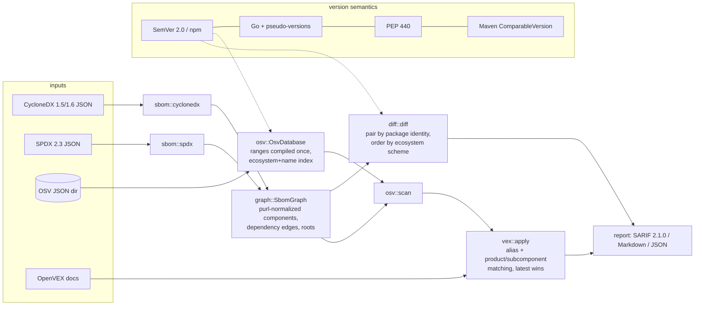

# sbomlens

An offline SBOM toolkit in Rust. It reads **CycloneDX 1.5/1.6** and **SPDX 2.3** JSON into one
normalized component graph, **diffs** two SBOMs, **matches** components against an offline
**OSV** database using each ecosystem's own version rules (SemVer for npm and crates.io,
PEP 440 for PyPI, Maven `ComparableVersion` ordering, Go module and pseudo-versions), applies
**OpenVEX** statements, and writes **SARIF 2.1.0**, Markdown or JSON.

The hard part of SBOM vulnerability matching is getting versions right. `1.10.0` sorts after
`1.9.0`. `1.0.dev1` sorts before `1.0a1`. `2.0-SNAPSHOT` sorts before `2.0`. `v0.0.0-2021…-e18ecbb05110`
falls before the fix `0.0.0-2022…`. sbomlens implements each ordering from its specification and
tests it against the specification's own examples.

**Who it is for:** engineers who already produce SBOMs (`npm sbom`, `uv export`, syft, cdxgen,
…) and want three things without sending data to a service: a reviewable diff between two
releases, a vulnerability report that CI can gate on (`--fail-on high`), and a way to record
triage decisions (OpenVEX) that stays in the report as an auditable suppression.

## Architecture



| Module | Responsibility |
|---|---|
| `purl` | Package URL parsing and canonical form. Passes all 59 cases of the official purl-spec test suite |
| `version::{semver, golang, pep440, maven, generic}` | Per-ecosystem parsing, normalization and total ordering |
| `ecosystem` | purl type ↔ OSV ecosystem ↔ version scheme, plus OSV package-name spelling (`group:artifact`, PEP 503) |
| `license` | SPDX expression parser and canonicalizer, so `MIT OR Apache-2.0` = `apache-2.0 or mit` |
| `sbom::{cyclonedx, spdx}` + `graph` | Format readers that build a de-duplicated component graph with shortest "introduced via" paths |
| `diff` | Added/removed/upgraded/downgraded/changed components and license changes |
| `osv::{db, range, matcher}` | Offline OSV loading, range compilation, OSV range evaluation, matching |
| `cvss` | CVSS v3.0/v3.1 base-score calculator used for severity |
| `vex` | OpenVEX 0.2.0 (and 0.0.1) parsing, validation and application |
| `report::{markdown, sarif}` + `cli` | Renderers and the `sbomlens` command |

Deeper design notes, algorithms and complexity are in [docs/ARCHITECTURE.md](docs/ARCHITECTURE.md).

## Quickstart

```sh
make check        # fmt + clippy (pedantic, -D warnings) + tests + coverage >= 80% + data checksums
make demo         # offline end-to-end demo over the bundled fixtures
cargo install --path .

sbomlens inspect my.cdx.json --tree 3
sbomlens diff release-1.cdx.json release-2.spdx.json -o diff.md
sbomlens scan my.cdx.json --osv path/to/osv-dir --vex triage.openvex.json \
    --format sarif -o results.sarif --fail-on high
sbomlens compare PyPI 1.0.dev1 1.0a1      # 1.0.dev1 < 1.0a1   [pep440]
sbomlens purl 'pkg:golang/golang.org/x/net@v0.0.0-20210226172049-e18ecbb05110'
```

`--osv` takes a directory of OSV JSON files, searched recursively. This is the layout of the
per-ecosystem `all.zip` exports from `osv-vulnerabilities.storage.googleapis.com` once unzipped.
It also takes a single JSON file holding one advisory or an array of them. Exit codes: `0` ok,
`1` the `--fail-on` threshold was reached, `2` error. Set `SBOMLENS_LOG=debug` (or pass `-v`)
for logs on stderr.

## Demo (real output of `make demo`, abridged)

```text
==> 2. Per-ecosystem version ordering
1.0.dev1 (pre-release) < 1.0a1 (pre-release)   [pep440]
1.0.post1 > 1.0+local.7   [pep440]
1.0-SNAPSHOT (pre-release) < 1.0   [maven]
30.1-jre < 32.0.0-android   [maven]
v0.0.0-20210226172049-e18ecbb05110 (pre-release) < 0.0.0-20220906165146-f3363e06e74c (pre-release)   [go]
1.0.0-beta.11 (pre-release) > 1.0.0-beta.2 (pre-release)   [npm]

==> 4. Diff two real SBOMs across formats (CycloneDX 1.5 -> SPDX 2.3)
$ sbomlens diff express-4.17.1.cdx.json express-4.21.2.spdx.json
| Components | 51 | 69 |
| Dependency edges | 85 | 124 |
**29 upgraded, 0 downgraded, 19 added, 1 removed, 0 changed, 0 license changes, 21 unchanged.**

==> 5. Scan express@4.17.1 against the pinned OSV subset with OpenVEX triage
- **Checked:** 51 of 51 components (0 without purl, 0 unsupported ecosystem, 0 without version)
- **OSV database:** 382 advisories from 382 files (0 withdrawn, 684 affected entries indexed)
- **Findings:** 13 active (13 distinct vulnerabilities after alias merge), 3 suppressed by VEX

| Severity | Package | Version | Advisory | Aliases | Fixed in | Introduced via |
| critical (9.1) | proxy-addr | 2.0.6 | GHSA-jqcg-44mw-7w3h | CVE-2026-90711 | 2.0.8 | express-4.17.1 > express > proxy-addr |
| high (7.5) | qs | 6.7.0 | GHSA-hrpp-h998-j3pp | CVE-2022-24999 | 6.7.3 | express-4.17.1 > express > qs |
| medium (6.1) | express | 4.17.1 | GHSA-rv95-896h-c2vc | CVE-2024-29041 | 4.19.2 | direct |
...
## Suppressed by VEX
| path-to-regexp | 0.1.7 | GHSA-9wv6-86v2-598j | not_affected | vulnerable_code_cannot_be_controlled_by_adversary | …#0 |
| cookie | 0.4.0 | GHSA-pxg6-pf52-xh8x | not_affected | vulnerable_code_not_in_execute_path | …#3 |
## Warnings
- …#5: ignored: not_affected requires a justification or impact_statement
- VEX statement …#4 matched no finding

==> 6. SARIF for the polyglot CycloneDX 1.6 fixture (cargo, Go, Maven, PyPI, npm)
SARIF 2.1.0: 90 rules, 90 results, levels {'error': 27, 'warning': 25, 'note': 38}
  - error GHSA-jfh8-c2jp-5v3q | org.apache.logging.log4j:log4j-core@2.14.1 is affected by GHSA-jfh8-c2jp-5v3q: Remote code injection in Log4j.
exit status with --fail-on critical: 1 (1 = policy failed, as expected for Log4Shell)

==> 7. Scan the Flask closure (PEP 440 matching), summary only
72 findings over 12 components:
  urllib3@1.26.14          20
  werkzeug@2.2.2           20
  ...
```

The full Markdown and SARIF outputs are kept as golden files in [`tests/golden/`](tests/golden).

## Design decisions (summary; full list in [DECISIONS.md](DECISIONS.md))

- **One graph for both formats.** CycloneDX and SPDX are converted into the same `SbomGraph`. A test
  checks that `npm sbom`'s CycloneDX and SPDX renderings of one dependency closure give identical
  component, edge and license sets.
- **Versions are typed per scheme, never compared as strings.** OSV ranges are compiled once at
  load time: events are parsed with the scheme the range type and ecosystem require, then sorted.
  When several events share one version, they are ordered as interval endpoints
  (`fixed` < `introduced` < `last_affected`). The property tests found that this rule was needed.
- **Refuse rather than guess.** `GIT` ranges and ecosystems without a known ordering (Debian,
  RubyGems, …) are counted and reported as not evaluable. Unknown orderings are never matched
  with a generic fallback. Such a fallback only labels diff entries, and those entries are marked
  `best_effort`.
- **VEX never deletes evidence.** `not_affected`/`fixed` findings stay in the report. They appear
  as SARIF suppressions with the justification. Invalid statements (for example `not_affected`
  without a justification) are ignored with a warning instead of silently suppressing findings.

## Evaluation and benchmarks

Every number below comes from a committed command. Output is pasted from runs on 2026-10-24
(macOS arm64, a machine shared with other builds, so timings vary between runs).

**1. Agreement with OSV.dev's own matcher** (`make eval`, i.e.
`cargo run --release --example agreement [-- --ranges-only]`). For every purl in the bundled
SBOMs, `scripts/fetch-osv-subset.py` recorded at fetch time which advisories api.osv.dev reported
(`fixtures/osv/expected-matches.json`). sbomlens then matched offline against the pinned subset:

| SBOM | OSV.dev pairs | sbomlens pairs | TP | FP | FN |
|---|---:|---:|---:|---:|---:|
| express-4.17.1 (CycloneDX 1.5 and SPDX 2.3, each) | 16 | 16 | 16 | 0 | 0 |
| express-4.21.2 (CycloneDX 1.5 and SPDX 2.3, each) | 8 | 8 | 8 | 0 | 0 |
| flask-2.2.2 closure (CycloneDX 1.5, uv) | 72 | 72 | 72 | 0 | 0 |
| polyglot-gateway (CycloneDX 1.6, hand-written) | 90 | 90 | 90 | 0 | 0 |
| **total** | **210** | **210** | **210** | **0** | **0** |

With `--ranges-only`, every advisory's enumerated `versions` list is dropped, so each match
must come from range evaluation with the version-ordering code. The result is again 210/210,
with 0 false positives and 0 false negatives.

**2. Version sweep** (`cargo run --release --example version_sweep`). OSV.dev enumerates the
versions covered by each Maven and PyPI advisory. The sweep checks that sbomlens' range
evaluation places every enumerated version inside the range, and every `fixed` version outside
it:

| Ecosystem | enumerated versions in range | `fixed` versions classified correctly |
|---|---:|---:|
| Maven | 11913 / 11913 | 300 / 300 |
| PyPI | 6511 / 6511 | 126 / 126 |
| npm | 1 / 1 | 93 / 93 |
| Go | – | 114 / 114 |
| crates.io | – | 30 / 30 |

**3. Matching benchmark** (`make bench`). The benchmark scans an SBOM of 5,001 components
against 20,000 seeded synthetic advisories. The indexed matcher is compared with a naive
matcher that checks every advisory against every component and parses versions on the fly.
Both must return the same 11,214 findings:

```text
load+index 382 advisories (684 indexed entries, 680 ranges): 26.021 ms
fixtures/sbom/real/express-4.17.1.cdx.json           parse   0.200 ms  scan   0.035 ms  (51 components, 16 findings)
fixtures/sbom/real/flask-2.2.2.cdx.json              parse   0.040 ms  scan   0.121 ms  (13 components, 72 findings)
index build (compile + index): 27.860 ms
indexed scan: 20.952 ms  (238690 components/s, 11214 findings)
naive scan:   1200.139 ms  (11214 findings)
speedup (scan only): 57x; index build + first indexed scan: 48.812 ms vs one naive scan: 1200.139 ms
```

Across runs on this shared machine, the naive scan took 1.0 to 1.6 s, so the speedup ranged
from 53x to 83x.

**4. Tests and coverage.** `make check` runs 61 unit tests and 44 integration, golden and
property tests. These include the purl-spec suite, ordering suites transcribed from SemVer §11,
PEP 440, Maven 3.9.9 `ComparableVersionTest` and the Go modules reference, and 8 proptest
properties. The library's line coverage, measured with
`cargo llvm-cov --ignore-filename-regex 'src/main\.rs' --summary-only`, is **96.9 %**. The gate
is 80 %.

**Size** (`python3 scripts/loc.py`): 5,820 lines of library and binary source, including doc
comments and blank lines. There are also 1,229 lines of unit tests inside `src/` and 1,990 lines
under `tests/`, `benches/` and `examples/`.

## Data

Sources, licenses and regeneration commands are in [DATA.md](DATA.md). In short:

- `fixtures/sbom/real/` holds SBOMs that first-party tools generated from real open-source
  dependency closures: `npm sbom` over `express@4.17.1` and `express@4.21.2`, and `uv export`
  over `flask==2.2.2` + `requests==2.28.1`. Resolution was pinned in time with
  `npm --before` / `uv --exclude-newer`. The script is `scripts/gen-real-sboms.sh`.
- `fixtures/sbom/synthetic/polyglot-gateway.cdx.json` is **hand-written**. It names real
  packages and versions, but the service it describes is fictional. It is the only CycloneDX
  1.6 sample and the only source of cargo, Go and Maven components.
- `fixtures/osv/db/` is a **pinned subset of 382 real OSV records** (2.4 MB). It covers every
  advisory, matching or not, for every package in the fixtures. `MANIFEST.json` stores a
  sha256 for each record, and `make verify-data` checks them.
- `fixtures/vex/express-4.17.1.openvex.json` is **hand-written demo triage**, not a statement by
  any real project.

## Limitations

- **The agreement eval is small and not independent.** It covers 210 (purl, advisory) pairs
  over 6 SBOMs, and its "truth" is OSV.dev's own matcher at one point in time. It shows agreement
  with OSV.dev, not correctness in an absolute sense. All six SBOMs were known before the eval
  was written, but nothing was tuned after it. One range-evaluation bug was found and fixed: a
  property test exposed the tie order of same-version events. The eval showed 100 % both before
  and after that fix. The polyglot fixture is hand-written.
- **Npm, Go and crates.io advisories carry no version enumerations**, so the version sweep
  checks only their `fixed` boundaries (237 cases). For those three ecosystems it assumes that
  ranges do not overlap.
- **Not evaluated:** `GIT` ranges (an SBOM has no commit graph), ecosystems other than npm,
  crates.io, PyPI, Maven and Go (Debian, RubyGems, NuGet, …), and purl-less components. These
  are counted in every report, but never matched.
- **npm** versions are parsed as strict SemVer after `v`/`=` trimming. Loose node-semver forms
  such as `1.2` are rejected, not coerced. Maven follows Apache Maven **3.9.9**'s ordering.
  Other resolvers (for example Gradle) differ in edge cases.
- **Severity:** CVSS **v4** vectors are not scored. The advisory's qualitative label is used
  when one exists, and the severity is `unknown` otherwise. 14 of the 72 Flask findings are
  `unknown` for this reason, all of them PYSEC records without a CVSS vector.
  `--fail-on` ranks `unknown` below `low`, so an unscored advisory never fails a build on its
  own.
- **VEX** product matching covers purls and exact `bom-ref`/`SPDXID` strings. CPE identifiers
  are read but only matched as exact strings. OpenVEX documents are not signature-checked.
- **SBOM coverage:** only JSON. XML CycloneDX, tag-value SPDX and SPDX 3.0 are rejected with a
  clear error. Merging CycloneDX `licenses[]` entries with `AND` is a choice. The spec leaves
  the semantics open.
- **CI** (`.github/workflows/ci.yml`) has not run yet: the repository has not been pushed.
- The benchmark is a single-machine micro-benchmark with synthetic advisories. Real OSV dumps
  are larger and have a different shape.

## Roadmap

- Stream the full per-ecosystem OSV `all.zip` exports without unpacking them.
- CVSS v4.0 scoring (MacroVector table).
- PURL-to-CPE fallback for ecosystems OSV does not cover.
- CycloneDX VEX (embedded `vulnerabilities[]`) as a second VEX input format.
- `diff --osv`: show which vulnerabilities an upgrade fixes or introduces.

## License

MIT. See [LICENSE](LICENSE).
