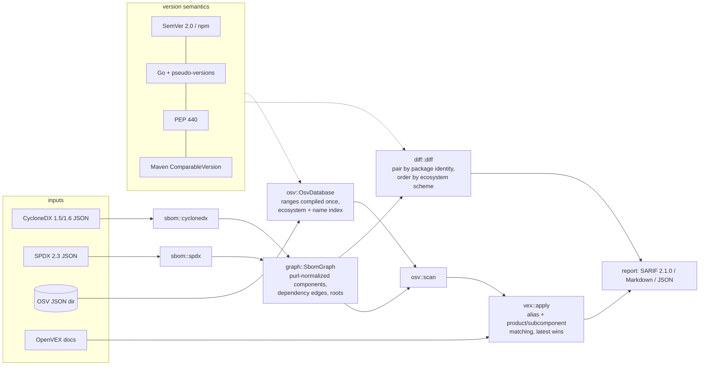

# sbomlens

An offline SBOM toolkit in Rust: normalize CycloneDX and SPDX, diff two SBOMs, and match
components against an OSV database with each ecosystem's real version rules, then apply OpenVEX
triage and emit SARIF, Markdown or JSON.

[](https://github.com/SlateGitOrg/sbomlens/actions/workflows/ci.yml)

## Why

The hard part of SBOM vulnerability matching is getting versions right, and every ecosystem
orders them differently. `1.10.0` sorts after `1.9.0`. On PyPI `1.0.dev1` sorts before `1.0a1`.
In Maven `2.0-SNAPSHOT` sorts before `2.0`. A Go pseudo-version such as
`v0.0.0-2021…-e18ecbb05110` falls before the fix `0.0.0-2022…`. A matcher that compares strings,
or uses one ordering for everything, quietly reports the wrong answer.

sbomlens is for teams that already produce SBOMs (`npm sbom`, `uv export`, syft, cdxgen, …) and
want three things without sending them to a service: a reviewable diff between two releases, a
vulnerability report CI can gate on (`--fail-on high`), and a way to record triage decisions
(OpenVEX) that stays in the report as an auditable suppression.

## Features

- **Two formats, one graph.** Reads CycloneDX 1.5/1.6 and SPDX 2.3 JSON (older CycloneDX 1.2–1.4
  and SPDX 2.2 with a warning) into one de-duplicated component graph with dependency edges,
  roots and shortest "introduced via" paths.
- **Per-ecosystem version semantics.** SemVer 2.0 (crates.io, npm front-end), Go modules and
  pseudo-versions, PEP 440 (PyPI) and Maven `ComparableVersion` (3.9.9), each tested against its
  specification's own examples.
- **Package URLs.** purl parsing and canonical form; passes all 59 cases of the official
  purl-spec test suite.
- **SBOM diff.** Added, removed, upgraded, downgraded and changed components plus license
  changes, with upgrade direction decided by the ecosystem's ordering.
- **Offline OSV matching.** Loads a directory of OSV JSON (for example the unpacked per-ecosystem
  `all.zip` exports), compiles every range once and indexes advisories by ecosystem and package.
- **OpenVEX 0.2.0 (and 0.0.1).** Suppresses or annotates findings by vulnerability id or alias
  and product, with timestamp precedence. Suppressed findings stay visible in every output.
- **Reports.** SARIF 2.1.0 (with `security-severity` and stable fingerprints), Markdown and JSON.
  CVSS v3.0/v3.1 base scores are computed from the vector.
- **CI-friendly exit codes.** `0` ok, `1` the `--fail-on` threshold was reached, `2` error.

## Architecture



Both SBOM formats are converted into the same `SbomGraph`, so everything downstream (diff, scan,
VEX, reports) is format-independent. The OSV database is parsed and its ranges compiled once per
run; a scan is then one hash lookup per component plus range evaluation. The CLI is a thin
wrapper over the library (`src/cli.rs`), so every command is tested in-process.

| Module | Responsibility |
|---|---|
| `purl` | Package URL parsing and canonical form |
| `version::{semver, golang, pep440, maven, generic}` | Per-ecosystem parsing, normalization and ordering, plus a panic-free sort |
| `ecosystem` | purl type ↔ OSV ecosystem ↔ version scheme, plus OSV package-name spelling (`group:artifact`, PEP 503) |
| `license` | SPDX expression parser and canonicalizer, so `MIT OR Apache-2.0` = `apache-2.0 or mit` |
| `sbom::{cyclonedx, spdx}` + `graph` | Format readers that build a de-duplicated component graph with shortest "introduced via" paths |
| `diff` | Added/removed/upgraded/downgraded/changed components and license changes |
| `osv::{db, range, matcher}` | Offline OSV loading, range compilation, OSV range evaluation, matching |
| `cvss` | CVSS v3.0/v3.1 base-score calculator used for severity |
| `vex` | OpenVEX parsing, validation and application |
| `report::{markdown, sarif}` + `cli` | Renderers and the `sbomlens` command |

Data model, algorithms and complexity are in [docs/ARCHITECTURE.md](docs/ARCHITECTURE.md).

## Quick start

Prerequisites:

- Rust **1.88+** with Cargo to run the test suite (the library and CLI build on **1.85+**; the
  `proptest` dev-dependency needs 1.88).
- Python **3.8+** (standard library only) for `make verify-data` and the demo's summaries.
- `make check` also needs `rustfmt`, `clippy` and
  [`cargo-llvm-cov`](https://github.com/taiki-e/cargo-llvm-cov) for the coverage gate.

Everything runs offline against the bundled fixtures.

```sh
git clone https://github.com/SlateGitOrg/sbomlens.git
cd sbomlens

# Build the CLI.
cargo build --release --locked

# Scan a real SBOM against the pinned OSV subset; exits 1 because a finding is >= high.
./target/release/sbomlens scan fixtures/sbom/real/express-4.21.2.spdx.json \
    --osv fixtures/osv/db --fail-on high

# Run the tests, or every CI gate (fmt, clippy -D warnings, tests, coverage >= 80%, data checksums).
cargo test --locked
make check

# End-to-end demo over all fixtures (writes reports to out/).
make demo

# Optional: install the binary into ~/.cargo/bin.
cargo install --locked --path .
```

## Usage

```text
sbomlens inspect <SBOM> [--tree N] [--format md|json]
sbomlens diff <OLD> <NEW> [--format md|json] [-o FILE]
sbomlens scan <SBOM> --osv <DIR|FILE> [--vex DOC]... [--format md|sarif|json]
              [-o FILE] [--fail-on low|medium|high|critical]
sbomlens purl <PURL>                    # normalized purl components as JSON
sbomlens compare <ECOSYSTEM> <A> <B>    # prints <, = or > under that ecosystem's ordering
```

`--osv` takes a directory of OSV JSON files, searched recursively, or a single file holding one
advisory or an array of them. `--fail-on` counts only active findings (after VEX), and an
unscored (`unknown`) severity never trips it on its own. Set `SBOMLENS_LOG=debug` (or pass `-v`)
for logs on stderr.

Version ordering per ecosystem (real output of `make demo`):

```text
$ sbomlens compare PyPI 1.0.dev1 1.0a1
1.0.dev1 (pre-release) < 1.0a1 (pre-release)   [pep440]
$ sbomlens compare Maven 30.1-jre 32.0.0-android
30.1-jre < 32.0.0-android   [maven]
$ sbomlens compare Go v0.0.0-20210226172049-e18ecbb05110 0.0.0-20220906165146-f3363e06e74c
v0.0.0-20210226172049-e18ecbb05110 (pre-release) < 0.0.0-20220906165146-f3363e06e74c (pre-release)   [go]
```

Diff across formats, CycloneDX 1.5 to SPDX 2.3:

```text
$ sbomlens diff fixtures/sbom/real/express-4.17.1.cdx.json fixtures/sbom/real/express-4.21.2.spdx.json
| Components | 51 | 69 |
| Dependency edges | 85 | 124 |
**29 upgraded, 0 downgraded, 19 added, 1 removed, 0 changed, 0 license changes, 21 unchanged.**
```

Scan with OpenVEX triage (abridged):

```text
$ sbomlens scan fixtures/sbom/real/express-4.17.1.spdx.json --osv fixtures/osv/db \
      --vex fixtures/vex/express-4.17.1.openvex.json
- **Checked:** 51 of 51 components (0 without purl, 0 unsupported ecosystem, 0 without version)
- **OSV database:** 382 advisories from 382 files (0 withdrawn, 684 affected entries indexed)
- **Findings:** 13 active (13 distinct vulnerabilities after alias merge), 3 suppressed by VEX

| Severity | Package | Version | Advisory | Aliases | Fixed in | Introduced via |
| critical (9.1) | proxy-addr | 2.0.6 | GHSA-jqcg-44mw-7w3h | CVE-2026-90711 | 2.0.8 | express-4.17.1 > express > proxy-addr |
| high (7.5) | qs | 6.7.0 | GHSA-hrpp-h998-j3pp | CVE-2022-24999 | 6.7.3 | express-4.17.1 > express > qs |
| medium (6.1) | express | 4.17.1 | GHSA-rv95-896h-c2vc | CVE-2024-29041 | 4.19.2 | direct |
...
## Suppressed by VEX
| path-to-regexp | 0.1.7 | GHSA-9wv6-86v2-598j | not_affected | vulnerable_code_cannot_be_controlled_by_adversary | …#0 |
| cookie | 0.4.0 | GHSA-pxg6-pf52-xh8x | not_affected | vulnerable_code_not_in_execute_path | …#3 |
## Warnings
- …#5: ignored: not_affected requires a justification or impact_statement
- VEX statement …#4 matched no finding
```

SARIF for the polyglot CycloneDX 1.6 fixture (cargo, Go, Maven, PyPI, npm):

```text
SARIF 2.1.0: 90 rules, 90 results, levels {'error': 27, 'warning': 25, 'note': 38}
  - error GHSA-jfh8-c2jp-5v3q | org.apache.logging.log4j:log4j-core@2.14.1 is affected by GHSA-jfh8-c2jp-5v3q: Remote code injection in Log4j.
exit status with --fail-on critical: 1
```

The full Markdown and SARIF outputs are kept as golden files in [`tests/golden/`](tests/golden).

## How it works

- **Versions are typed per scheme, never compared as strings.** OSV ranges are compiled once at
  load time: each event is parsed with the scheme its range type and ecosystem require, and the
  events are sorted. When several events share one version they are ordered as interval
  endpoints (`fixed` < `introduced` < `last_affected`); a property test found that this rule is
  needed. Evaluation then follows the OSV schema's algorithm and reports the closing event as
  "fixed in" or "affected through".
- **Maven is reproduced exactly, cycles included.** Maven's `ComparableVersion` is not
  transitive for some unusual spellings: Maven 3.9.9 itself orders `1-a < 1-ga-alpha < 1 < 1-a`.
  sbomlens keeps those pairwise results, because OSV's Maven ecosystem is defined by Maven's own
  comparison, and sorts versions with a stable merge sort that cannot panic on such input. On
  consistent input it gives exactly what `sort_by` would.
- **Refuse rather than guess.** `GIT` ranges and ecosystems without a known ordering (Debian,
  RubyGems, …) are counted and reported as not evaluable, never matched with a generic fallback.
  The fallback only labels diff entries, which are then marked `best_effort`.
- **VEX never deletes evidence.** `not_affected`/`fixed` findings stay in the report as SARIF
  suppressions with the justification. Invalid statements (for example `not_affected` without a
  justification) are ignored with a warning instead of silently suppressing findings.
- **Diff pairing.** Versions present on both sides pair as unchanged; the rest are sorted with
  the ecosystem ordering and paired in order, so npm trees holding one package in several
  versions produce sensible upgrades instead of a removal plus an addition.

Every design decision, with its reason and the cost if it is wrong, is in [DECISIONS.md](DECISIONS.md).
The threat model is in [docs/THREAT_MODEL.md](docs/THREAT_MODEL.md).

### Evaluation and benchmarks

Every number below comes from a committed command (macOS arm64, a machine shared with other
builds, so timings vary between runs).

**Agreement with OSV.dev's own matcher** (`make eval`). For every purl in the bundled SBOMs,
`scripts/fetch-osv-subset.py` recorded at fetch time which advisories api.osv.dev reported
(`fixtures/osv/expected-matches.json`). sbomlens then matched offline against the pinned subset:

| SBOM | OSV.dev pairs | sbomlens pairs | TP | FP | FN |
|---|---:|---:|---:|---:|---:|
| express-4.17.1 (CycloneDX 1.5 and SPDX 2.3, each) | 16 | 16 | 16 | 0 | 0 |
| express-4.21.2 (CycloneDX 1.5 and SPDX 2.3, each) | 8 | 8 | 8 | 0 | 0 |
| flask-2.2.2 closure (CycloneDX 1.5, uv) | 72 | 72 | 72 | 0 | 0 |
| polyglot-gateway (CycloneDX 1.6, hand-written) | 90 | 90 | 90 | 0 | 0 |
| **total** | **210** | **210** | **210** | **0** | **0** |

With `--ranges-only`, every advisory's enumerated `versions` list is dropped, so each match must
come from range evaluation. The result is again 210/210 with no false positives or negatives.

**Version sweep** (`cargo run --release --example version_sweep`). OSV.dev enumerates the
versions covered by each Maven and PyPI advisory. The sweep checks that range evaluation places
every enumerated version inside the range and every `fixed` version outside it:

| Ecosystem | enumerated versions in range | `fixed` versions classified correctly |
|---|---:|---:|
| Maven | 11913 / 11913 | 300 / 300 |
| PyPI | 6511 / 6511 | 126 / 126 |
| npm | 1 / 1 | 93 / 93 |
| Go | – | 114 / 114 |
| crates.io | – | 30 / 30 |

**Matching benchmark** (`make bench`). An SBOM of 5,001 components is scanned against 20,000
seeded synthetic advisories, comparing the indexed matcher with a naive one that checks every
advisory against every component and parses versions on the fly. Both must return the same
11,214 findings:

```text
load+index 382 advisories (684 indexed entries, 680 ranges): 17.879 ms
fixtures/sbom/real/express-4.17.1.cdx.json           parse   0.127 ms  scan   0.019 ms  (51 components, 16 findings)
fixtures/sbom/real/flask-2.2.2.cdx.json              parse   0.028 ms  scan   0.070 ms  (13 components, 72 findings)
index build (compile + index): 24.572 ms
indexed scan: 14.504 ms  (344793 components/s, 11214 findings)
naive scan:   681.628 ms  (11214 findings)
speedup (scan only): 47x; index build + first indexed scan: 39.076 ms vs one naive scan: 681.628 ms
```

Across runs on this shared machine the scan-only speedup ranged from 44x to 83x.

## Testing

```sh
cargo test --locked   # unit, integration, golden and property tests
make coverage         # cargo llvm-cov, fails under 80 % line coverage
make check            # what CI runs: fmt, clippy (pedantic, -D warnings), tests, coverage, data checksums
make eval             # OSV.dev agreement and version sweep
```

The suite has 68 unit tests and 47 integration tests, including 11 proptest properties. It
covers:

- the official purl-spec suite and ordering suites transcribed from SemVer §11, PEP 440, Maven
  3.9.9 `ComparableVersionTest` and the Go modules reference;
- cross-format equality: `npm sbom`'s CycloneDX and SPDX renderings of one closure give identical
  component, edge and license sets;
- an OSV.dev agreement gate on every fixture, VEX semantics, CLI exit codes and golden Markdown and
  SARIF reports;
- properties: purl round-trips, PEP 440 spelling equivalence, order axioms, OSV range evaluation
  against an interval model, and panic-free diffs and sorts over adversarial version mixes.

Library line coverage (`cargo llvm-cov --ignore-filename-regex 'src/main\.rs' --summary-only`) is
**97.0 %**; the gate is 80 %. CI also builds the library and CLI on the 1.85 MSRV and runs the
demo, evals and benchmark.

## Project layout

```text
src/
  cli.rs, main.rs        command-line interface (main.rs is a thin wrapper)
  sbom/, graph.rs        CycloneDX and SPDX readers, normalized component graph
  purl.rs, ecosystem.rs  Package URLs and ecosystem mapping
  version/               SemVer, Go, PEP 440, Maven and generic orderings
  osv/                   OSV database, range compilation and matcher
  vex.rs, cvss.rs        OpenVEX application, CVSS v3 scoring
  diff.rs, report/       SBOM diff, Markdown and SARIF renderers
tests/                   integration, golden, property and spec-suite tests
examples/                agreement and version_sweep evaluations
benches/matching.rs      indexed vs naive matching benchmark
fixtures/                real and synthetic SBOMs, pinned OSV subset, demo VEX
scripts/                 demo, data regeneration and manifest verification
docs/                    architecture and threat model
```

## Data

Sources, licenses and regeneration commands are in [DATA.md](DATA.md). In short:

- `fixtures/sbom/real/` holds SBOMs that first-party tools generated from real open-source
  dependency closures: `npm sbom` over `express@4.17.1` and `express@4.21.2`, and `uv export`
  over `flask==2.2.2` + `requests==2.28.1`, pinned in time with `npm --before` /
  `uv --exclude-newer`.
- `fixtures/sbom/synthetic/polyglot-gateway.cdx.json` is **hand-written**. It names real
  packages and versions, but the service it describes is fictional. It is the only CycloneDX 1.6
  sample and the only source of cargo, Go and Maven components.
- `fixtures/osv/db/` is a **pinned subset of 382 real OSV records** (2.4 MB) covering every
  advisory, matching or not, for every package in the fixtures. `MANIFEST.json` stores a sha256
  per record, and `make verify-data` checks them.
- `fixtures/vex/express-4.17.1.openvex.json` is **hand-written demo triage**, not a statement by
  any real project.

## Limitations

- **The agreement eval is small and not independent.** It covers 210 (purl, advisory) pairs over
  6 SBOMs, and its "truth" is OSV.dev's own matcher at one point in time. It shows agreement with
  OSV.dev, not correctness in an absolute sense, and the polyglot fixture is hand-written.
- **npm, Go and crates.io advisories carry no version enumerations**, so the version sweep checks
  only their `fixed` boundaries (237 cases) and assumes their ranges do not overlap.
- **Not evaluated:** `GIT` ranges (an SBOM has no commit graph), ecosystems other than npm,
  crates.io, PyPI, Maven and Go (Debian, RubyGems, NuGet, …), and purl-less components. These are
  counted in every report but never matched.
- **npm** versions are parsed as strict SemVer after `v`/`=` trimming; loose node-semver forms
  such as `1.2` are rejected, not coerced. **Maven** follows Apache Maven 3.9.9's ordering, cycles
  included; other resolvers (for example Gradle) differ in edge cases.
- **Severity:** CVSS v4 vectors are not scored. The advisory's qualitative label is used when one
  exists, otherwise `unknown`. 14 of the 72 Flask findings are `unknown` for this reason (PYSEC
  records without a CVSS vector).
- **VEX** product matching covers purls and exact `bom-ref`/`SPDXID` strings. CPE identifiers are
  only matched as exact strings, and OpenVEX documents are not signature-checked.
- **SBOM coverage:** JSON only. XML CycloneDX, tag-value SPDX and SPDX 3.0 are rejected with a
  clear error. Combining several CycloneDX `licenses[]` entries with `AND` is a choice; the spec
  leaves the semantics open.
- The benchmark is a single-machine micro-benchmark with synthetic advisories. Real OSV dumps are
  larger and shaped differently.

## Roadmap

- Stream the full per-ecosystem OSV `all.zip` exports without unpacking them.
- CVSS v4.0 scoring (MacroVector table).
- PURL-to-CPE fallback for ecosystems OSV does not cover.
- CycloneDX VEX (embedded `vulnerabilities[]`) as a second VEX input format.
- `diff --osv`: show which vulnerabilities an upgrade fixes or introduces.

## License

MIT — see [LICENSE](LICENSE).
