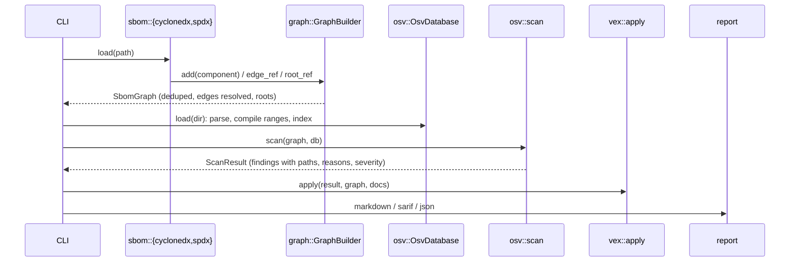

# sbomlens architecture

This document covers the data model, the algorithms behind the parts that matter for
correctness (purl normalization, the four version orderings, OSV range evaluation, VEX
resolution, diff pairing) and their complexity.

## Pipeline



## Data model

`SbomGraph` (`src/graph.rs`) contains:

- `components: Vec<Component>`. Each component has a source reference (`bom-ref`/`SPDXID`),
  name, group, document version, an optional parsed `Purl`, the `Ecosystem` that purl implies,
  an optional canonical `License`, and a kind.
- `edges: Vec<Vec<usize>>`. These are sorted, de-duplicated adjacency lists meaning "depends
  on or contains".
- `roots: Vec<usize>`. These are the components the document describes. When the document
  names none, every component without an incoming edge is a root.
- `warnings`. These record non-fatal problems: invalid purls, dangling relationships,
  purl/version disagreements, older spec versions.

`GraphBuilder` resolves references after all components are added. A component whose purl
(minus subpath) was already seen is merged, and its reference becomes an alias. Syft-style
SBOMs list one package once per location, so this merge is common.

Component identity:

| purpose | key |
|---|---|
| de-duplication inside one SBOM | canonical purl with version and qualifiers, without subpath |
| pairing across two SBOMs (diff) | `Purl::package_key()` (type/namespace/name), or `name:<group/name>` without a purl |
| OSV lookup | `(Ecosystem, OSV package name)`. Maven is `group:artifact`, PyPI names are PEP 503-normalized |

### Format mapping

**CycloneDX** (`src/sbom/cyclonedx.rs`). `metadata.component` becomes the root. Nested
`components[]` get a containment edge from their parent. `dependencies[]` become dependency
edges. When the document has no `dependencies` section at all, every top-level component
becomes a child of the root. `licenses[]` entries are parsed: `id` and `expression` go through
the SPDX parser, while `name` stays free text. The entries are then combined with `AND`.

**SPDX** (`src/sbom/spdx.rs`). Relationships are normalized to one direction:

| forward (A → B) | reversed (B → A) |
|---|---|
| `DEPENDS_ON`, `CONTAINS`, `HAS_PREREQUISITE`, `STATIC_LINK`, `DYNAMIC_LINK` | `DEPENDENCY_OF`, `{DEV,OPTIONAL,BUILD,TEST,RUNTIME,PROVIDED}_DEPENDENCY_OF`, `CONTAINED_BY`, `PREREQUISITE_FOR` |

Roots come from `documentDescribes`, from `DESCRIBES` relationships whose source is the
document, and from `DESCRIBED_BY` relationships that point to the document. The license is
`licenseConcluded`, unless that is `NOASSERTION`/`NONE`, in which case `licenseDeclared` is
used.

## Package URLs

`src/purl.rs` follows the purl-spec parsing procedure. The string is split right to left:
`#subpath`, then `?qualifiers`, then the scheme, type, `@version` and namespace/name. Each part
is percent-decoded. The type-specific rules that affect identity are then applied:

- `pypi`: names are lower-cased and `_` becomes `-`.
- `github`, `bitbucket`, `composer`: namespace and name are lower-cased.
- `huggingface`: versions are lower-cased.
- `mlflow`: names on Databricks are lower-cased.
- Validation rules: `conan` channel/namespace pairing, `swift`/`cran`/`hackage` require a
  version, and `cpan` restricts module and distribution names.

`Display` produces the canonical form. Qualifiers are sorted, empty values are dropped, and
everything outside `[A-Za-z0-9.-_~:]` is percent-encoded, except that `/` is kept in qualifier
values. The official test suite (59 cases) passes. A property test checks that
`parse(display(p)) == p` for arbitrary components, including reserved characters and Unicode.

## Version orderings

All schemes parse into `version::Version`. One scheme always produces one variant, so ordering
is total within a scheme. `Version::key()` is an equality key consistent with `cmp`, used for
membership in OSV `versions` lists.

### SemVer 2.0.0 (crates.io; npm and Go front-ends)

`SemVer` follows §11 precedence. `major.minor.patch` compare numerically. A pre-release sorts
below its release. Pre-release identifiers compare pairwise: numeric identifiers sort below
alphanumeric ones, numeric identifiers compare numerically, and alphanumeric ones compare in
ASCII order. A shorter prefix sorts lower. Build metadata is ignored, and `Eq` agrees with
that. The strict parser rejects leading zeros and empty identifiers.

- **npm** first trims whitespace and a leading `=`/`v`, the same normalization node-semver's
  `clean` performs.
- **Go** makes the `v` optional, because OSV writes Go versions without it. It also accepts the
  `vMAJOR`/`vMAJOR.MINOR` shorthands. `+incompatible` is build metadata. Pseudo-versions need
  no special ordering rule, because they are already valid SemVer pre-releases:
  - `vX.0.0-yyyymmddhhmmss-rev` sorts below any `vX.0.x` tag;
  - `vX.Y.(Z+1)-0.yyyymmddhhmmss-rev` sorts above `vX.Y.Z` and below `vX.Y.(Z+1)`;
  - `vX.Y.Z-pre.0.yyyymmddhhmmss-rev` sorts above `vX.Y.Z-pre` and below `vX.Y.Z-pre.1`.

  Timestamps within one base compare as ASCII text, which is chronological order.
  `golang::pseudo_version` decodes the base tag, timestamp and revision for reports.

### PEP 440 (PyPI)

`src/version/pep440.rs` is a hand-written, backtracking-free parser for the PEP's permissive
grammar. It handles the optional `v`, epochs, release segments, `a|alpha|b|beta|rc|c|pre|preview`
with optional separators and implicit numbers, post releases as `-N` or
`[.-_]post|rev|r[.-_]N`, `dev` releases, and local versions. The ordering key mirrors the PEP's
summary table:

| field | value when absent | notes |
|---|---|---|
| epoch | 0 | |
| release | – | trailing zeros removed (`1.0 == 1.0.0`) |
| pre | +∞, or **−∞ when the version is only a dev release** | makes `1.0.dev1 < 1.0a1` |
| post | −∞ | |
| dev | +∞ | `1.0a1.dev1 < 1.0a1` |
| local | −∞ | segments: numeric > alphanumeric, then numeric/lexicographic, prefix sorts lower |

### Maven

`src/version/maven.rs` re-implements Apache Maven 3.9.9 `ComparableVersion`:

1. Lower-case the string. Split it on `.`, `-` and digit/letter transitions. Each `-` and each
   transition opens a nested list. Under MNG-7644, `.X` followed by a digit is treated like
   `-X`.
2. Items are integers of any size (compared by length, then lexically), qualifiers, and lists.
   A single-letter qualifier followed by a digit expands: `a`→`alpha`, `b`→`beta`,
   `m`→`milestone`. `ga`, `final` and `release` become `""`, and `cr` becomes `rc`.
3. Each list is normalized innermost-first: trailing "null" items (`0`, `""`, empty list) are
   removed. Non-empty sublists are skipped while scanning backwards.
4. Qualifier order: `alpha < beta < milestone < rc < snapshot < "" < sp < other` (others
   compare lexically). Padding comparisons follow Maven exactly, including MNG-6964's
   "compare the whole list with null".

`canonical()` renders the normalized tree and serves as the equality key.

### Generic fallback

Unknown ecosystems use runs of digits and letters, with numbers sorting above words. This
ordering is used **only** to label diff entries, which are then marked `best_effort`. It is
never used for vulnerability matching.

## OSV matching

### Loading and compiling (`src/osv/db.rs`, `src/osv/range.rs`)

For each `affected[]` entry with a known ecosystem:

1. Each range is compiled with `CompiledRange::compile`:
   - The scheme is chosen by `scheme_for(range.type, ecosystem)`. `SEMVER` ranges use SemVer,
     with the npm or Go front-end for those ecosystems. `ECOSYSTEM` ranges use the ecosystem's
     own scheme. `GIT` ranges and ecosystems without a known ordering are rejected and counted.
   - Each event is parsed. `introduced: "0"` becomes −∞ and `limit: "*"` becomes +∞.
   - Events are sorted by version. When several events share one version, they are ordered as
     interval endpoints: `fixed < introduced < last_affected`. This gives `[i=X, l=X]` the
     meaning "exactly X" and `[f=X, i=X]` the meaning "re-introduced at X", independent of the
     order the document lists them in.
2. Enumerated `versions` are stored twice: as raw strings, and as equality keys under the
   ecosystem scheme.
3. The entry is pushed to `index[(ecosystem, normalized name)]`.

### Range evaluation

This is the OSV schema's evaluation algorithm, plus explanation of the result:

```
open = None
for e in sorted events:
    if e.introduced and e.version <= v:      open = e
    elif e.fixed and e.version <= v:         open = None
    elif e.last_affected and e.version < v:  open = None
affected = open is not None and (no limits or any(v < limit))
```

When `v` is affected, the closing event is the first `fixed > v` or `last_affected >= v`. It is
reported as "fixed in", or as "affected through".

### Scan (`src/osv/matcher.rs`)

For each component with a purl, a known ecosystem and a version:

1. One hash lookup returns the advisories for `(ecosystem, package)`.
2. The component version is parsed lazily, at most once per scheme (`VersionCache`).
3. Each compiled range is evaluated, and the enumerated versions are checked. One advisory is
   reported at most once per component.

A single breadth-first search from the roots provides the shortest "introduced via" path and
the direct-or-transitive flag for every finding.

### Complexity

Let *A* be the number of advisories, *E* the total number of events, *C* the number of
components, and *k* the number of advisory entries for one package (small in practice).

| step | time | space |
|---|---|---|
| load + compile + index | O(E log E) (sorting each range's events) | O(E + A) |
| scan | O(C + edges) for the BFS, plus Σ over components of O(k · events per range) | O(C) |
| naive baseline (benchmark) | O(C · A · events), plus re-parsing | O(1) extra |
| diff | O(N log N) over both SBOMs (sorting per identity) | O(N) |
| VEX apply | O(F · S) for F findings and S statements | O(S) |

`benches/matching.rs` measures the indexed scan against the naive baseline. Both must return
identical findings.

## VEX resolution (`src/vex.rs`)

- **Validation.** Each statement needs a vulnerability with a name, at least one product, and a
  valid status. `not_affected` needs a justification or an impact statement, and the
  justification must be one of the five OpenVEX labels. An `affected` statement without an
  action statement is accepted with a warning. Invalid statements are dropped with a warning.
- **Matching.** A statement applies to a finding when its vulnerability identifiers (name,
  `@id`, aliases) intersect the finding's identifiers (id and aliases), and either:
  - a product identifier matches the vulnerable component itself, or
  - a product matches a component on the shortest path from a root, and either no
    subcomponents are listed or one of them matches the vulnerable component.

  Purl identifiers match on package identity. A product purl without a version matches every
  version. Versions are compared with the ecosystem's equality key, so `1.0` matches `1.0.0` on
  PyPI. Qualifiers on the statement must be present on the component. Any other identifier must
  equal the component's `bom-ref`/`SPDXID`.
- **Precedence.** The latest statement timestamp wins. A statement without a timestamp falls
  back to the document's. RFC 3339 offsets are normalized to UTC. On a tie, the statement given
  later wins: later in the document, or in a document given later on the command line.
- **Effect.** `not_affected` and `fixed` suppress the finding. It stays in JSON output, and in
  SARIF it appears as an `external`, `accepted` suppression. `affected` and
  `under_investigation` annotate the finding. Statements that matched nothing are listed so
  stale triage can be found.

## Diff pairing (`src/diff.rs`)

For every identity present in either SBOM:

1. Duplicate versions within one side are removed.
2. Versions present on both sides, by equality key, pair as unchanged.
3. The remaining old and new versions are each sorted with the ecosystem scheme, falling back
   to the generic ordering, and then paired in order. Each pair is classified as upgraded,
   downgraded, or changed (when the versions cannot be ordered). Leftover old versions are
   reported as removed, and leftover new versions as added.
4. Each pair is checked for a license change by comparing canonical, case-insensitive keys.

Pairing in sorted order handles npm trees that contain one package in several versions. For
example, `debug@2.6.9` and `debug@4.3.4` become `debug@2.6.9` and `debug@4.4.0`: one unchanged
pair and one upgrade, instead of a removal plus an addition.

## Reports

- **Markdown.** A summary, a severity table, a findings table (with fix version, CVE aliases and
  the path), VEX suppressions and annotations, skipped components, and warnings. Table cells
  are escaped.
- **SARIF 2.1.0.** One rule per advisory, carrying `security-severity` (the CVSS score, or
  GitHub's representative score for a label) and the CVSS vector. One result per finding, with
  a physical location (the SBOM file, line 1), a logical location (the purl), a stable FNV-1a
  `partialFingerprints` value, and the dependency path in `properties`.
- **JSON.** A serde dump of the report structs, intended for further processing.
